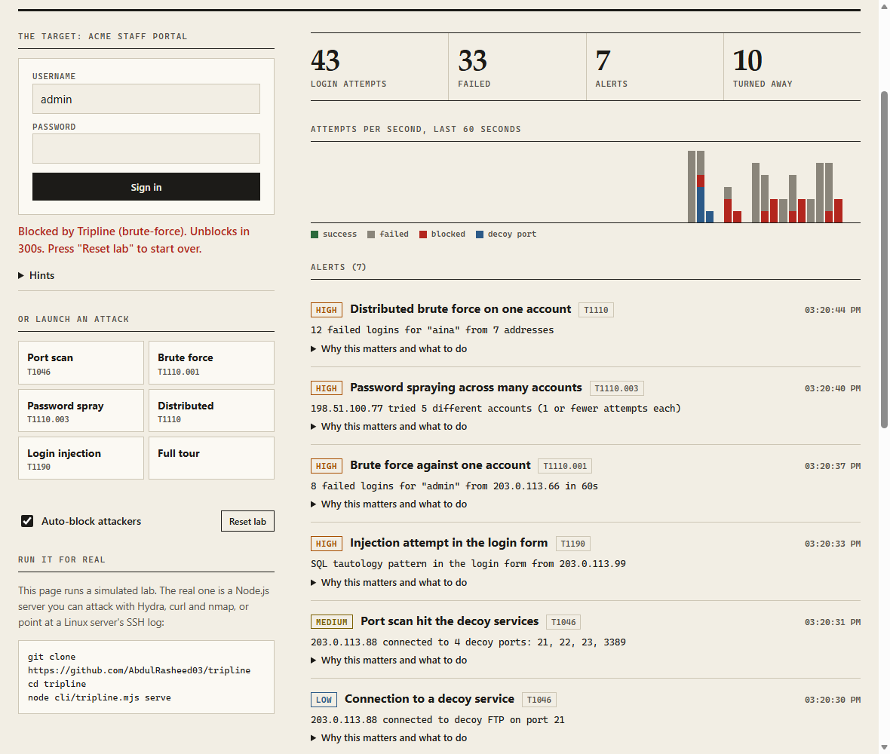

# Tripline

**Try to break in. It is watching.**

Tripline is a live attack detection lab. It runs a login page you are allowed to attack, then catches you in real time: brute force, password spraying, distributed attacks, login injection and port scans. Every alert is mapped to MITRE ATT&CK, explained in plain language, and answered automatically by blocking the attacker or locking the account.

You can attack it with its own simulator or with real tools (Hydra, curl, nmap), and you can point the same engine at a real server's SSH log, nginx / Apache access log, or Windows Security log. Every investigation can be exported as a Markdown incident report, ready for a ticket.

**[Try the demo in your browser](https://abdulrasheed03.github.io/tripline/)**: guess the admin password and watch yourself get blocked. No install.



## What it catches

| Attack | Rule | MITRE ATT&CK | Response |
|:--|:--|:--|:--|
| Brute force | 8 failed logins on one account from one address within 60 s | T1110.001 | Block the address |
| Password spraying | One address tries 5 or more accounts, 3 tries or fewer each, within 5 min | T1110.003 | Block the address |
| Distributed brute force | 12 or more failures on one account from 4 or more addresses within 5 min | T1110 | Lock the account (blocking one address would not help) |
| Low and slow brute force | 20 failures from one address within an hour, never fast enough to trip the burst rule | T1110.001 | Block the address |
| Possible compromise | A successful login from an address that just failed 5 or more times | T1078 | **Critical.** Block the address and lock the account |
| Login injection | SQL, script, template or NoSQL syntax in the username or password | T1190 | Block the address |
| Port scan | One address connects to 4 or more decoy ports within 60 s | T1046 | Block the address |
| Decoy touch | Any connection to a decoy service | T1046 | Note only (low) |

From web server access logs (nginx, Apache):

| Attack | Rule | MITRE ATT&CK | Response |
|:--|:--|:--|:--|
| Vulnerability scanner | User-Agent of sqlmap, Nikto, Nuclei, gobuster, ffuf, wpscan and 20 more | T1595.002 | Block the address |
| Directory brute forcing | 20 requests for missing pages from one address within 60 s | T1595.003 | Block the address |
| Web login brute force | 10 POSTs to a login page (`wp-login.php`, `xmlrpc.php`, `/login`, `/signin`, `/users/sign_in`, `Login.aspx` and similar) from one address within 60 s, whatever the status. A lone redirect among the failures is called out as a possible successful login | T1110 | Block the address |
| Injection or traversal in a URL | SQL, script, command or path traversal syntax, after URL decoding (twice, to catch double encoding) | T1190 | Block the address |
| Probe for secrets | Requests for `.env`, `.git/config`, database dumps, `phpinfo.php`, `server-status` and similar | T1083 | Alert |
| Secret file served | Any of those answered with 2xx | T1552.001 | **Critical.** Its own alert per file, so later probes can never bury it |

From the Windows Security log (event IDs 4625, 4624 and 4740), every login rule above works on RDP, SMB and console logons, plus:

| Attack | Rule | MITRE ATT&CK | Response |
|:--|:--|:--|:--|
| Windows locked an account | Event 4740, with the failed logons Tripline saw for that account just before it | T1110 | Alert (Windows already locked it) |

Every alert in the dashboard has a "why this matters and what to do" section written for the analyst on shift.

## Demo it in one minute

You need [Node.js](https://nodejs.org) 20 or newer. There are no packages to install.

```bash
git clone https://github.com/AbdulRasheed03/tripline
cd tripline
node cli/tripline.mjs serve
```

Open http://localhost:3000. In a second terminal, attack it:

```bash
node cli/tripline.mjs attack tour     # scan, injection, brute force, spray, distributed
```

Then untick **Auto-block attackers** on the dashboard and run `attack brute` again. This time the attacker cracks `admin`, and Tripline raises a critical *Successful login after many failures* alert. Detection still works when prevention is switched off, which is how most real breaches are found.

| Scenario | What it does |
|:--|:--|
| `scan` | Connects to a range of ports, including the decoys |
| `brute` | Top 20 leaked passwords against `admin` |
| `spray` | 3 seasonal passwords against 10 accounts |
| `distributed` | 6 addresses take turns guessing `aina` |
| `injection` | Classic login-bypass payloads |
| `slow` | One guess every 9 seconds, about 3 minutes |
| `tour` | All of the above except `slow` |

Each simulated attacker uses its own loopback address (127.0.0.66, 127.0.0.77 ...), so the dashboard shows separate sources without faking any headers.

### Attack it with real tools

Tripline does not care what is attacking it:

```bash
# Hydra against the portal form
hydra -l admin -P wordlist.txt -s 3000 127.0.0.1 http-post-form "/login:username=^USER^&password=^PASS^:F=Invalid"

# curl by hand
curl -d "username=admin&password=guess" http://127.0.0.1:3000/login

# nmap connect scan across the decoys (FTP 2121, SSH 2222, Telnet 2323, VNC 5901, Elasticsearch 9201)
nmap -sT -p 2000-10000 127.0.0.1
```

A SYN scan (`nmap -sS`) never completes the handshake, so the decoys do not see it. That is a real limitation of connection-level honeypots, and it is why the README says `-sT`.

The portal page is at http://localhost:3000/portal. The demo accounts and their passwords are in [src/labdata.js](src/labdata.js) on purpose.

## Watch a real server

The same engine reads OpenSSH logs from `/var/log/auth.log` (Debian, Ubuntu) or `/var/log/secure` (RHEL), in classic syslog or ISO timestamp format.

```bash
# Alerts in the terminal as they happen
sudo node cli/tripline.mjs watch /var/log/auth.log

# Live dashboard fed by the real log
sudo node cli/tripline.mjs serve --watch /var/log/auth.log

# Investigate a saved log after the fact
node cli/tripline.mjs replay samples/auth.log
```

The same commands read nginx and Apache access logs, and Tripline tells the formats apart on its own:

```bash
node cli/tripline.mjs replay /var/log/nginx/access.log
node cli/tripline.mjs replay samples/access.log --md > incident.md   # Markdown incident report
```

The included [samples/access.log](samples/access.log) has an sqlmap run, a gobuster burst, someone fetching `/.git/config` (and getting it), and a path traversal attempt, mixed with normal visitors whose URLs only *look* dangerous (`/blog/union-select-guide`, `?q=O'Brien`). Tripline flags every attacker and none of the visitors.

The incident report has a summary, the alerts ordered by severity with MITRE links, the analyst guidance for each, the sources and a block list. Text that came from the attacker is always neutralised (no backticks, pipes or newlines, and inside a code span), so a hostile username or URL cannot inject links or fake sections into your ticket. The dashboard has the same report on its **Incident report** button.

`replay` exits with code 2 when it finds anything high or critical, so it can run from cron or CI. The included [samples/auth.log](samples/auth.log) has a root brute force, an invalid-user spray, a low and slow attacker, a weak `deploy` account that gets cracked, and a real admin who mistypes once. Tripline raises exactly one alert per attacker and nothing for the admin.

```
samples/auth.log: 82 login events over 1h 07m, 4 alert(s)

 HIGH  Brute force against one account  T1110.001
       34 failed logins for "root" from 203.0.113.45 in 60s
 HIGH  Password spraying across many accounts  T1110.003
       198.51.100.23 tried 10 different accounts (1 or fewer attempts each)
 CRITICAL  Successful login after many failures  T1078
       "deploy" logged in from 198.51.100.61 after 7 failures from that address
 MEDIUM  Low and slow brute force  T1110.001
       25 failed logins from 203.0.113.200 over 1h 00m, never fast enough to trip the burst rule
```

### Windows servers and workstations

Export the Security log from an elevated PowerShell, then replay it. Two formats work:

```powershell
# XML, one event per line (also works with tripline watch)
Get-WinEvent -FilterHashtable @{LogName='Security'; Id=4624,4625,4740} -MaxEvents 20000 | ForEach-Object { $_.ToXml() } | Out-File -Encoding utf8 security.xml

# JSON (Select-Object matters: without it every field becomes a type name, and Tripline tells you so)
Get-WinEvent -FilterHashtable @{LogName='Security'; Id=4624,4625,4740} -MaxEvents 20000 | Select-Object TimeCreated, Id, Properties | ConvertTo-Json -Depth 4 | Out-File security.json

node cli/tripline.mjs replay security.xml
```

Event Viewer's **Save All Events As... > XML** and `wevtutil qe Security /f:xml` work too, and so do UTF-16 files from Windows PowerShell 5.1.

How the events are read:

* **4625** (failed logon) becomes a failed login from `IpAddress`. SubStatus `0xC0000064` marks an account that does not exist, like "invalid user" in SSH.
* **4624** (successful logon) becomes a success, so a brute force that ends in a logon raises the critical **Successful login after many failures** alert. Logons Windows makes for itself are dropped first: service, batch and system logon types, `SYSTEM` and the service accounts, machine accounts ending in `$`, `ANONYMOUS LOGON`, and the `DWM-` and `UMFD-` virtual accounts. Without this, a quiet server logs thousands of "successes" an hour.
* **4740** (account locked out) raises **Windows locked an account**. On a domain this event is written on the domain controller, and it names the caller computer instead of an address.
* Account names are compared without case, because `Administrator` and `ADMINISTRATOR` are the same account to Windows. `::ffff:203.0.113.5` and `203.0.113.5` count as one source. A console logon has no address and shows as `local`.

The included [samples/security.xml](samples/security.xml) has an RDP brute force on Administrator that ends in a lockout, an SMB password spray, a `backup` account that is guessed and then logs in, a user with one RDP typo, and the usual background noise from Windows itself. Tripline flags the three attackers and nothing else.

## How it works

```
  attacker ──HTTP──▶ portal /login ──┐
  attacker ──TCP───▶ decoy ports ────┤
  sshd ──────────▶ auth.log (tail) ──┤
                                     ▼
                          detection engine  (src/engine.js, pure function of events)
                                     │
                    alerts + actions │  block address / lock account
                                     ▼
              Server-Sent Events ──▶ dashboard (web/)
```

* **The engine is pure.** Events go in, alerts and actions come out. It never reads the clock or touches the network; time comes from each event. That is what lets the same file run in the live server, the log watcher, the browser demo and the tests, and it makes every rule replayable.
* **Passwords never reach the engine.** The login handler checks the password, looks for injection patterns, and throws it away. The engine only sees the username, the address, success or failure, and the *name* of an injection pattern. A test sends a password nine times and then searches the server's state for it.
* **One alert per attack, not per attempt.** Repeat hits update the open alert. Each rule keeps its alert open for its own window, so a slow attacker guessing every 2.5 minutes for an hour produces one alert. The first version raised a fresh alert every few guesses (seven for the sample log); the test that caught it is still there.
* **Block or lock, depending on the attack.** Blocking one address stops a brute force but not a distributed one, so that rule locks the account instead.
* **The dashboard treats attacker input as hostile.** Usernames like `<script>alert(1)</script>` are inserted as text, never HTML, and a strict Content Security Policy blocks inline scripts.

## Safety

* The lab listens on `127.0.0.1` only, unless you pass `--host`, which prints a warning.
* The attack simulator refuses any target that is not this machine. There is a test for that.
* The control endpoints (reset, auto-block switch, run scenario) only answer requests from this machine.
* Only attack systems you own or have written permission to test.

## Limitations

These are deliberate trade-offs, and they are worth knowing before trusting any detector:

* **Shared addresses.** Many users behind one office NAT or mobile carrier look like one source. A busy office can trip the brute force rule. Real deployments allow-list known egress addresses.
* **Thresholds are guesses.** 8 failures per minute suits a small portal. Tune them in [src/engine.js](src/engine.js) (`DEFAULTS`) for your traffic.
* **State is in memory.** Restarting the server forgets blocks and history. A production version would persist state and share it across servers.
* **No geolocation or reputation.** Impossible-travel and known-bad-IP checks need online services, which this lab avoids.
* **Blocking is application level.** Tripline refuses logins; it does not change the firewall. Exporting blocks to `nftables` or `fail2ban` is on the roadmap.

## Tests

```bash
npm test
```

49 tests cover each rule at and just below its threshold, false positives (a real admin's typo, a web user who mistypes once, page views and blog posts with "login" in the URL, passwords like `Kopi2026#` and `O'Brien` that contain SQL characters, harmless URLs that look like attacks), the SSH, web and Windows log formats (XML, JSON from PowerShell 5.1 and 7, UTF-16 files, Windows noise that must not count as logons), Markdown injection into the incident report, the live feed text for every event type, and end-to-end runs against a live server: blocked mid-attack, cracked with blocking off, scans caught on the decoys, injection never logging in, passwords never leaking, path traversal refused, and the simulator refusing outside targets.

## Project layout

```
src/engine.js      Detection rules, alerting, block and lock decisions (pure, no I/O)
src/parsers.js     OpenSSH auth.log, nginx / Apache access log and JSON line parsing
src/windows.js     Windows Security events 4624, 4625 and 4740 (XML or Get-WinEvent JSON)
src/report.js      Markdown incident report (pure, shared by CLI and dashboard)
src/labdata.js     Demo accounts and attack wordlists
server/lab.mjs     Live server: portal, decoys, event stream, control API
server/attacks.mjs Attack simulator (loopback only)
cli/tripline.mjs   serve, attack, replay, watch
web/               Dashboard, browser demo lab, portal page
tests/             node --test suites
samples/auth.log   Example SSH log with four attackers
samples/access.log Example nginx log with five web attackers and normal visitors
samples/security.xml Example Windows Security log with three attackers and Windows noise
```

## Roadmap

* Export blocks to `nftables`, `ufw` or `fail2ban`
* Windows Kerberos and NTLM events (4771, 4776) for domain controllers
* Persist alerts to a file and replay them into the dashboard

## Licence

MIT. See [LICENSE](LICENSE).
